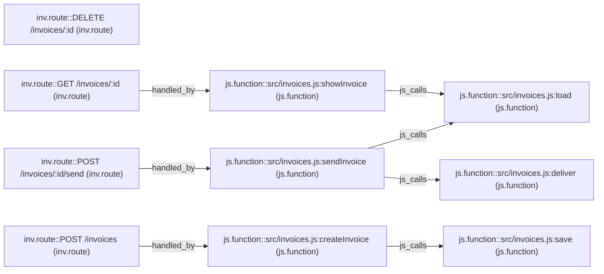

<div align="center">

# Periplus

**Map your code. Understand your system. Keep what you learn.**

A deterministic, framework-aware semantic code graph, for people and AI agents.

[](https://github.com/camoa/periplus/actions/workflows/checks.yml)
[](LICENSE)
[](https://github.com/camoa/periplus/tags)
[](pyproject.toml)

Status: **beta**, version 0.10.3.

</div>

> *periplus* (n.): an ancient coastal record of the ports and the distances between them.
>
> *rutter* (n.): a mariner's book of written sailing directions for one coast, from the French
> *routier*; it told a pilot what to look for before charts did.

Code stays. What a team understands about it does not. It lives in people's heads, and in AI
sessions that start from nothing every time. Periplus turns that understanding into files you
keep.

Periplus reads a code base and writes a map: the classes, routes, hooks, templates and settings
it was told to look for, and the links between them, each with the file and line where it was
found. The same code, settings and rutters, on the same version of Periplus, give the same map,
byte for byte. Making it needs no AI and no server. A person or an AI agent asks the map first, to
find where to look: what calls this, what breaks if this changes, every way a request reaches
this method. They read the code there to confirm what it does, and where the map has no answer.
What they learn is kept as rules and descriptions.

### Without a map, and with one

| Without a map | With a map |
|---|---|
| Search the code for a word | Ask the map what is linked to a thing |
| Read files to find what depends on what | Follow the links, each with its file and line |
| Work it out again in the next session | Start from the map and the descriptions, and read the code they point to |
| A different route through the code each time | The same map each time, from the same code, settings, rutters and version |
| What you learned stays in the chat | What you learned becomes a rule or a description |
| One word with several meanings, found out late | Each thing listed with its type and place, so the meanings show first |

### Five things to know

- **The engine** runs rules and writes the map. Knowledge of a language or a framework belongs in
  rutters, never in the engine. When rules cannot express a pattern, the engine gains a general
  ability that every rutter can use.
- **Rutters** hold the knowledge of one stack, such as PHP, Drupal or Laravel, as small YAML
  rules. Each rule finds one thing, and rules build on what other rules found. File names and
  settings call a rutter a *pack*: it lives in a folder named `<pack>@<version>`.
- **The map** is one JSON file of nodes and edges. Each link carries the file and line where it
  was found, and each thing found in the code carries its own. A thing only named by a link has
  none. A reference a rule found and could not resolve, or that is decided at run time, is in the
  map and marked. A thing or link that no rule looks for is not in the map, and nothing marks its
  absence.
- **Descriptions** say in plain words what a thing does. They sit beside the map in their own
  file, so facts and words stay apart. `periplus stamp` ties a description of a thing to that
  thing's code, so a stamped description shows as stale once the code changes. Descriptions of
  links are not stamped.
- **Skills** teach an AI agent to use all of this: to set a project up, to answer from the map, to
  analyse code with it, to describe what it reads, to connect the docs to the code, to find what
  the map lacks, and to write the rule that fills the gap.

The routes of [`examples/rule-composition`](examples/rule-composition) and what handles them, cut
by `periplus slice --path config/ --out routes.map.json` and drawn by
`periplus export --format mermaid --map routes.map.json`:



### What to expect

A map is not the code, and Periplus is not magic. The map holds what its rutters look for. A
link that no rule reads is not in the map, so a missing link does not show that the code has
none. The map also holds no run-time behaviour. What it gives is a steady base: the same answer
to the same question, and a place where each gap you find becomes a rule. The map holds that link
from then on.

In the project's own runs on one code base, the work with a map was steadier from run to run. A
map improved with new rules and descriptions helped more than the map as first built. On the map
as first built, the side without a map reported more likely problems, and the first job took
longer with the map. The likely problems were counted, not tested. See
[the evals page](docs/evals.md).

### Where to go next

| You want to | Read |
|---|---|
| Make a first map | [Get started](#get-started), below |
| Ask the map questions yourself | [Navigating the map](docs/navigation.md) |
| Have an AI agent use the map | [Using the map with an AI agent](docs/using-the-map-with-an-agent.md) |
| Understand how the parts fit | [How Periplus fits together](docs/architecture.md) and [Principles](docs/principles.md) |
| Make the map hold more | [Write a rutter](#write-a-rutter), below, and [Extending Periplus](docs/extending-periplus.md) |
| Read what `periplus map` reports | [Reading the map report](docs/map-report-guide.md) |
| Judge how complete a map is | [Judging a map](docs/mapping-quality.md) |
| Find a quick answer | [Questions and answers](docs/faq.md) |
| Look up a word | [Glossary](docs/glossary.md) |
| See every page | [The docs index](docs/README.md) |

An AI agent that works in this repository, or uses Periplus in another one, starts at
[`AGENTS.md`](AGENTS.md).

## Contents

- [Get started](#get-started)
- [Why Periplus](#why-periplus)
- [What the map holds](#what-the-map-holds)
- [Write a rutter](#write-a-rutter)
- [Read the map](#read-the-map)
- [CLI reference](#cli-reference)
- [Troubleshooting](#troubleshooting)
- [Tests and checks](#tests-and-checks)
- [How Periplus behaves](#how-periplus-behaves)
- [License](#license)

## Get started

Periplus needs Python 3.11 or later. It declares support for 3.11 to 3.14.

If you work through an AI agent, do step 1, then ask the agent to set the project up, as in
[Using the map with an AI agent](docs/using-the-map-with-an-agent.md#things-you-can-ask).

### 1. Install Periplus

Install it from PyPI:

```
uv tool install periplus-map                # or: pip install periplus-map
periplus --version
```

To install a tagged version from the repository:

```
uv tool install git+https://github.com/camoa/periplus@v0.10.3
```

To install from a local copy of this repository:

```
uv tool install /path/to/periplus           # or: pip install /path/to/periplus
```

After any of these installs, run `periplus skills install` to copy the Claude skills Periplus
ships into `~/.claude/skills`. Run it again after an update to replace the older copies.

#### Use the skills with other agents

The skills follow the [Agent Skills](https://agentskills.io) format: a folder with a `SKILL.md`
file. After `periplus skills install`, the folders `periplus-setup`, `periplus-map`,
`periplus-analyze`, `periplus-describe`, `periplus-document`, `periplus-gaps` and
`periplus-rutter` are in `~/.claude/skills`. Copy them to the folder the agent reads, and copy them
again after each update. The folder `~/.agents/skills` serves four agents at once:

```
mkdir -p ~/.agents/skills && rsync -a --delete ~/.claude/skills/periplus-* ~/.agents/skills/
```

- [Codex CLI](https://learn.chatgpt.com/docs/build-skills): `~/.agents/skills`, or `.agents/skills` in a repository.
- [Gemini CLI](https://geminicli.com/docs/cli/skills/): `~/.gemini/skills` or `~/.agents/skills`, or `.gemini/skills` or `.agents/skills` in a workspace.
- [GitHub Copilot in VS Code](https://code.visualstudio.com/docs/copilot/customization/agent-skills): `~/.copilot/skills`, `~/.agents/skills` or `~/.claude/skills`, so the Claude install already works. A repository can use `.github/skills`.
- [Cursor](https://cursor.com/docs/context/skills): `~/.cursor/skills` or `~/.agents/skills`, and it also reads `~/.claude/skills`. A repository can use `.cursor/skills`.

To upgrade an install from PyPI, use the tool you installed with:

```
uv tool upgrade periplus-map
pipx upgrade periplus-map
pip install -U periplus-map
```

`uv tool upgrade` leaves an install pinned to an exact version, such as `periplus-map==0.5.1`, where
it is. For that one, run `uv tool install periplus-map@latest`.

Then run `periplus skills install` again, and repeat the copy above for any other agent. Read the
[changelog](CHANGELOG.md) before you upgrade: when a bundled rutter's version changes, update the
pins in your project's settings with `periplus update` and map again.

To update a local install, pull the repository and run `uv tool install /path/to/periplus` again. A
local directory is rebuilt when `pyproject.toml` changes or a file under `src/periplus` does. Run
`uv tool install --reinstall /path/to/periplus` for the form that always rebuilds. The command
`periplus status` prints a `rutters:` digest of the bundled rutters, so you can compare two installs.

The distribution name is `periplus-map`. Its seven runtime dependencies are pinned exactly. One
package that `jsonschema` brings is compiled, so your platform needs a prebuilt wheel or Rust.

To work on Periplus itself, run `uv sync --frozen --all-extras` in the repository. This installs
the development tools into `.venv`.

### 2. Pin a rutter

Run `periplus init` in the project folder. It creates `.periplus/`, a pack folder and a commented
settings file. It pins each bundled rutter whose detector matches the project, and writes the
folders it found where a rutter's default folder does not exist:

```
cd /path/to/project
periplus init
```

The settings file, `.periplus/settings.yml`, names the rutters to load, each pinned to an exact
version:

```yaml
periplus_version: 0
packs:
  - drupal_basic@0.3.0
folders:
  config: ./config/default
```

The `folders` line moves the config folder from `drupal_basic`'s default, `./config/sync`. Leave
it out when your site uses the default.

In a Drupal project, `periplus init` pins `drupal_basic@0.3.0` when `composer.json` names
`drupal/core` or `web/core/lib/Drupal.php` exists. It also pins each contributed-module rutter,
such as `webform_basic`, whose module `core.extension.yml` lists, plus `drush_basic` for Drush
commands and `drupal_js_basic` for scripts in custom modules and themes. It prints one line per
pin with the file that matched. Where `web/modules/custom`, `web/themes/custom` or `config/sync`
do not exist, it looks for the `docroot/` and project-root versions and `config/default`. It
writes each one it finds under `folders` and prints what it chose. A folder it found nowhere is
printed as `unplaced`; declare it under `folders` yourself. The rutters that `drupal_basic`
depends on load without a pin of their own. After you update Periplus, run `periplus update` to
bring the pins to the installed versions.

Outside Drupal, `init` pins `laravel_basic` when `composer.json` requires `laravel/framework`, and
`go_basic` for a `go.mod`. It pins `nextjs` when `package.json` names `next` or a `next.config`
file exists, `typescript` for a `tsconfig.json`, and `react` for a `.tsx` file in `src`. It pins
`php_basic` for PHP files in the project folder or `src`, and `js_basic` for `index.js` or scripts
in `src` or `lib`. A stack in a subfolder is not detected. When nothing matches, `init` says so.
`go_basic` needs `module` and `typescript` needs `typescript_alias_root` under `values`; without
them `periplus map` stops at exit 26.

### 3. Map the project

```
periplus map
```

`periplus map` writes the map to `.periplus/map.json`, where the other commands look for it.
Beside it, it writes `.periplus/map.inputs.json`, the record that `periplus fresh` reads to say
whether the map still matches the code; commit both. It also prints a run report. It names each rule and how often it fired, and the files
no rule read. A pinned rutter that selected no file is listed first, under `Packs that selected no
file`, with the folders it looked in. Exit 33 means no rutter selected any file: `map` writes no
map, leaves an existing one as it was, and asks you to declare where the code is under `folders`
in `.periplus/settings.yml`. The report also names folders it could not list, files that did not parse, and rules it
could not run. The [map report guide](docs/map-report-guide.md) reads each part in turn.

### 4. Ask the map

```
periplus types
periplus find TEXT
periplus show ID
```

`periplus --help` lists every command that reads the map, grouped by what it is for.
[Navigating the map](docs/navigation.md) says which command answers which question.

An AI agent tends to skip the map and search by words. [Using the map with an AI
agent](docs/using-the-map-with-an-agent.md) gives requests to copy that make it use the map.

## Why Periplus

**What you work out is kept.** You ask the map, and the answer lists each link
with its file and line. The next question, the next session and the next person start from the
same map and from the descriptions already written. When the map lacks a link, you write the rule
once, and every later map holds it.

How the work changes:

- **Framework code is in the map.** Rutters read configuration, templates and settings files as
  they read source files. A route, a service or a hook is in the map with the code that uses it.
- **A new stack does not wait for a release.** You teach Periplus a stack it does not know with a
  rutter of YAML rules, in your own project.

The map helps as much as its rutters hold, and each rule you add makes it help more. Installing
Periplus alone is not enough.

The map is one file you commit, with the inputs record beside it that `periplus fresh` reads.
Nothing serves it.
[`docs/principles.md`](docs/principles.md) gives the reasons for this design: why a new mapper,
and why rutters and not built-in support for each stack. The table compares Periplus with the
kinds of tool that page describes.

| | Periplus | A source indexer | A server-backed tool | An AI summary |
|---|---|---|---|---|
| Framework configuration and templates | Read by rutter rules, as the source files are | Little or nothing | Little or nothing | What the model happens to read |
| What you get | One JSON file to commit, compare and review | An index for the tool's own queries | A database behind a server or viewer | Ranked text made for one prompt, never saved |
| What it needs to run | The command line | The tool | A database, a server or a viewer | A model |
| A new stack | A new rutter | Code in the tool | Code in the tool | A new prompt |

## What the map holds

The map is one JSON file, `.periplus/map.json`. Its nodes are the things the rutters found, and its
edges are the links between them. Each edge carries the file and line where it was found, and
each node found in the code carries its own. A node only named by an edge has none. Each carries
the rutter and rule that found it, and the rule's declared confidence: `declared`, `inferred` or
`mentioned`, strongest first.

The engine writes five states:

- `mapped`: a rule found the thing in a file the project holds.
- `boundary`: the thing is outside the mapped code, and a rule says what it is.
- `unknown_boundary`: the thing leaves the mapped code and no rule says what it is, or it is a
  call site whose target is built at run time. The node records why.
- `unresolved`: a rule looked for a name inside the mapped code and no rule maps it. The node
  records what was searched.
- `referenced`: a file names the thing, but no rule read where it is defined. Drupal core is an
  example when only custom code is mapped.

An unresolved node from a map of a Drupal site, shortened: a method calls `my_module_format()`,
which no mapped file declares.

```json
{"id": "php.function::my_module_format",
 "state": "unresolved", "type": "php.function",
 "unresolved_detail": {"rule": "php_basic/calls_function", "found": "no mapped node of this name",
   "searched_for": "my_module_format", "types_tried": ["php.function"]}}
```

**Determinism.** The same code, settings and rutters, on the same version of Periplus, give the
same map, byte for byte. The design aims for identical maps on every machine.

<details>
<summary><strong>The map file, field by field</strong></summary>

The map holds the nodes, the edges, counts by type and by kind, the packs
loaded and the settings file used. When it holds an edge of a kind its rutter declares grouping
(`groups: true`: the edge's `from` end belongs to the container at its `to` end), it lists those
kinds, sorted, under `grouping_kinds`. `legend` holds the texts its rutters give its node types
and edge kinds, and the four `cause_..._kinds` lists sort its edge kinds by cause, as
[`periplus legend`](docs/navigation.md#legend) prints them. When a node holds
an attribute its rutter gives a mark, `marks` names the mark of each such attribute.
`part_types` names each type whose things are mostly parts of what holds them, as parameters,
with its share in percent, counted over the whole map; a slice carries it. Each node has an `id`, a `type`, a `state` and its `locations`
(file and line, empty for a node only named by an edge). Its `provenance` names the pack, the rule and the rule's declared confidence: `declared`,
`inferred` or `mentioned`, strongest first. Rules that reach one node or edge at different
confidences each keep their own row.

Each edge has `from`, `to`, `kind`, its locations, an `occurrences` count and its provenance, and
`attributes` when a rule wrote some, such as the key a form callback is registered under; an edge
found at several places with different values keeps each place's value.

- A call whose target is built at run time, such as `$this->$name()`, is a call-site node, as
  `php.call_site`, whose `attributes` hold `resolution: runtime`. The map keeps the call and draws
  no edge from it, because no rule can name the target. A node of a type a rutter marks
  `internal` serves that rutter's map rules and is left out of the written map, with every edge
  that has an end on it.
- A node that two rules type as two kinds of one type, such as two kinds of form, keeps the type
  both kinds descend from. Its `attributes` hold `type_conflict`, each candidate type with the
  pack and rule that gave it, and the map report lists it under Type conflicts.

</details>

### The rutters provided

What the map holds depends on the rutters loaded. A rutter is one of three kinds.
[Bundled rutters](docs/rutters.md) says what each maps and what it depends on.

- **Ships with the package**, and loads by its pin alone:
  - Languages and file types: `php_basic`, `js_basic`, `go_basic`, `typescript`, `react`,
    `nextjs`, `yaml_basic` and `twig_basic`.
  - Drupal: `drupal_basic`, `drupal_js_basic` and `drupal_more`, plus 14 rutters for contributed
    modules, each pinned beside `drupal_basic` when the site uses that module.
  - Laravel: `laravel_basic`.
- **An example in the repository:** `python_text`, `typer_text` and `speckitty`, in
  `examples/second-stack/packs`. Copy one into `.periplus/packs`, or name its folder under
  `pack_paths`, then pin it. Python is not read out of the box.
- **Any other stack:** write a rutter, as [Write a rutter](#write-a-rutter) shows.

What each release added is in the [changelog](CHANGELOG.md). Run `periplus skills install` after
upgrading.

## Write a rutter

A rutter for a new stack is a folder of YAML files in the project. You write it, map the
project, read what the map cannot explain, and write the next rule.

### The loop

1. Run `periplus init` in the project folder. It creates `.periplus/packs/` and the settings file
   `.periplus/settings.yml`. It pins a bundled rutter when it recognises the stack. For a new
   stack, write a first rutter and pin it, as in the example below.
2. Run `periplus map --output map.json --format json >report.json`. A map needs at least one
   pinned rutter, and with none it stops at exit 17.
3. Read the unknowns. In the report, `unread` lists the files in the rules' folders that no rule
   read. `skipped` lists each match whose rule could not build a node or edge it emits, with the
   reason. `not_executed` lists the rules the engine cannot run, and why. In the map,
   `counts.nodes_by_state` counts the `referenced` nodes, which a file names but no rule maps. It
   also counts the `unresolved` nodes, which a rule looked for and did not find.
4. Write a rule for those names in a rutter under `.periplus/packs/`. Pin a new rutter under
   `packs` in the settings. To build on a bundled rutter, name it in `depends`, as
   `depends: [php_basic]`. Your rutter may then use its folders, file types and types, and add
   rules. The bundled rutter's own files stay as installed.
5. Run `periplus validate <pack>`. It names each file and place that disagrees with the schemas,
   and reports what `periplus map` refuses the rutter for before it reads a file. A rutter that
   does not validate stops the map.
6. Map again. The unknowns you covered disappear. Go back to step 3.

### Where a rutter and its settings live

A project's own rutters sit in `.periplus/packs/`, one folder per rutter, named
`<pack>@<version>`. Each holds a manifest, `pack.yaml`, and pack files: every other `.yaml` or
`.yml` file, in any subfolder.

The settings file, `.periplus/settings.yml`, holds these keys, among others. The file that
`periplus init` writes names every key Periplus reads, each with a comment.

- `packs`: the rutters to load, each pinned as `<pack>@<version>`. A pinned rutter's dependencies
  load without a pin of their own.
- `folders`: a new place for a folder that a rutter names. A project that keeps the example's
  lists in `todo` sets `folders: {lists: ./todo/**}`. The rules then read `todo` and every folder
  below it.
- `values`: named text values that any template of any rutter may name, such as `{module}`.
- `pack_paths`: more folders to find rutters in, relative to the project folder.
- `re_include`: globs that take back the files a rutter's `files.exclude` leaves out.

`periplus status` lists where Periplus looks for a pinned rutter: the project's
`.periplus/packs`, the user configuration directory, the bundled rutters and each `pack_paths`
folder. A bundled rutter, such as `php_basic`, loads by its pin alone.

### A complete small rutter

This rutter reads a line format invented for this example, a list of chores. A line
`chore <name>` declares a chore. `after <name>` at its end names the chore it waits for. Write
these four files in an empty folder.

<!-- example: .periplus/settings.yml -->
```yaml
periplus_version: 0
packs:
  - chores@0.0.1
```

<!-- example: .periplus/packs/chores@0.0.1/pack.yaml -->
```yaml
pack: chores
version: 0.0.1
depends: []
folders:
  lists: ./lists
files:
  types:
    chores:
      endings: [chores]
      reader: text
```

<!-- example: .periplus/packs/chores@0.0.1/rules/chores.yaml -->
```yaml
node_types:
- name: chores.chore
  id_namespace: chores.chore
edge_kinds:
- kind: waits_for
  from: chores.chore
  to: chores.chore
rules:
- rule: chore
  reads: file
  in: [lists]
  match: {file: '*', filetype: chores, text: '(?m)^chore (?<name>\w+)'}
  id: {from: {capture: name}}
  emits: [{node: {type: chores.chore}}]
  confidence: declared
- rule: chore_waits
  reads: file
  in: [lists]
  match: {file: '*', filetype: chores, text: '(?m)^chore (?<name>\w+) after (?<after>\w+)'}
  id: {from: {capture: name}}
  emits: [{edge: {kind: waits_for, from: this_node, to: {from: {capture: after}}}}]
  confidence: declared
```

<!-- example: lists/home.chores -->
```text
# the week
chore dishes
chore laundry after dishes
chore floors after sweeping
```

`pack.yaml` gives the rutter's name and version, a folder `lists`, and a file type `chores` for
files ending in `.chores`, read as text. The pack file declares the node type `chores.chore` and
the edge kind `waits_for`. The rule `chore` fires once per match of its `text` pattern, and the
capture `name` gives the node's id. The rule `chore_waits` adds a `waits_for` edge from that node
to the name after `after`. `periplus validate` refuses one rule that emits both the node and the
edge, so the edge has its own rule. `confidence: declared` says the file states the thing.

Run `periplus validate chores`, then `periplus map --output map.json`. The map holds exactly these
nodes and edges, each with its state or kind and its file and line:

<!-- example-map -->
```text
node chores.chore::dishes   mapped      lists/home.chores:2
node chores.chore::laundry  mapped      lists/home.chores:3
node chores.chore::floors   mapped      lists/home.chores:4
node chores.chore::sweeping referenced
edge chores.chore::laundry  waits_for  chores.chore::dishes    lists/home.chores:3
edge chores.chore::floors   waits_for  chores.chore::sweeping  lists/home.chores:4
```

`sweeping` is `referenced`: line 4 names it, and no rule maps it. That is the kind of unknown
that step 3 of the loop finds.

### What to read next

- `periplus spec` prints the contract: the schemas, the rule format, the engine, and what the
  format cannot say yet. `periplus spec <pack>` adds what one rutter declares and inherits.
- [Writing a rutter](docs/rutter-author-guide.md) is the guide to start with: the files of a
  rutter, one rule of each shape, and how to check a rutter. The
  [docs index](docs/README.md#how-to-guides) lists the other guide pages and what each covers.
- [Extending Periplus](docs/extending-periplus.md) helps you choose between a new rule, a new
  rutter and an engine change.
- `examples/second-stack/packs` holds three working rutters to copy.

## Read the map

The commands after the set-up group in `periplus --help` read a written map, and stop. They read the map, the descriptions file and
the source line under each row, and nothing more. Most are small commands that do one job each:
count, list or fetch one kind of answer. Two macros, `reach` and `slice`, combine them in one
reply. `periplus --help` lists them all, grouped by job, and `periplus <command> --help` gives the
options of one.

`periplus check-map` runs the full schema check that the other commands skip. The
[navigation guide](docs/navigation.md) says which command answers which question, how `--ids` and
`-` join two commands, and each command's options, output and exit codes.

### Draw part of the map

`periplus slice --out FILE` writes a piece of the map to a map file of its own, and `periplus
export` prints a map as GraphML, DOT or Mermaid. To draw a part of the map, slice it to a file,
then export the slice. A slice is a smaller map, so name it so it cannot replace the full map.

```
periplus slice --path src/Billing/ --out billing.map.json
periplus export --format graphml --map billing.map.json > billing.graphml   # open in Gephi Lite
periplus export --format dot --map billing.map.json > billing.dot           # render with Graphviz
periplus export --format mermaid --map billing.map.json > billing.mmd       # wrap in a mermaid code fence in a pull request
```

Gephi Lite handles light graphs; use Gephi for more than about 10,000 nodes. Mermaid on GitHub may
not draw a graph above 500 edges or 50,000 characters, and the export warns when it passes either.
[Visualize the map](docs/visualize-the-map.md) says more.

## CLI reference

Run each command in the project folder. These commands set up a project and build the map. The
commands that read the map are in [Read the map](#read-the-map) and the
[navigation guide](docs/navigation.md).

```
periplus init                      # create .periplus/ and a settings file, pinning the rutters and folders it finds
periplus status                    # report the settings, where each value came from, and the pack search path
periplus spec [PACK] [--summary]   # print the rutter contract, and what one rutter declares and inherits
periplus validate PACK             # check one rutter against the schemas and what map refuses it for
periplus update                    # move each pin to the installed version of that rutter
periplus map                       # map this project and write .periplus/map.json, with a run report
periplus check-map                 # check every node and edge of the map against the map schema
periplus fresh                     # say whether the map still matches the code, settings, rutters and tool
periplus skills install            # copy the Claude skills Periplus ships into ~/.claude/skills
```

`periplus validate` takes a bare `name`, or `name@version` to pick one of several copies.
`periplus update` leaves project-local and unknown pins as they are. Every command but `init`, `skills`
and `export` takes `--format json`. Every command that reads one map takes `--map PATH`.
`periplus --version` prints the installed version, and `periplus <command> --help` gives each
command's options.

## Troubleshooting

- **`periplus map` stops at exit 17.** The project pins no rutter, so there is nothing to map.
  Run `periplus init`, or pin a rutter under `packs` in `.periplus/settings.yml`. Exit 17 also
  marks a map that fails its own schema, which is an engine defect. Nothing is written in
  either case.
- **`periplus map` stops at exit 28: a grammar mismatch.** A rutter's `grammar` in `pack.yaml`
  pins a parser runtime or a grammar version other than the one installed, or one that is not
  installed. The message names the rutter, the package, the version pinned and the version
  found. For a language other than PHP, Go and JavaScript, install its `tree-sitter-<language>`
  package at the pinned version. The check runs before any
  source file is opened.
- **`periplus map` stops at exit 33: no file was selected.** Every pinned rutter looked only in
  folders that hold none of its files, so no map was written and an existing map was left as it
  was. The report's first section names each rutter and the folders it looked in. Declare where
  the code is under `folders` in `.periplus/settings.yml`.
- **A navigation command stops at exit 29, 30 or 31.** It found no map, the file is not a map,
  or the id names no node. The [navigation guide](docs/navigation.md) gives the remedy for each.

## Tests and checks

The pytest suite tests the engine and the bundled rutters. The acceptance scripts in
`scripts/demo.d` each map a small project and compare the result with what it expects. The CI
workflow behind the checks badge runs pytest on Python 3.11 to 3.14, ruff and mypy, and validates
every bundled pack. It does not run the acceptance scripts, and it never maps a Go project.
`scripts/demo.d/99s-map-determinism.sh` maps one project in separate processes under different
hash seeds and locales, and compares the bytes of the maps. No check compares maps built on two
machines.
[`CONTRIBUTING.md`](CONTRIBUTING.md) says how to run each, and how to propose a change.

## How Periplus behaves

The engine and the map format work as follows. Each rutter's `pack.yaml` header says what it does
not map yet.

- **Keys accepted but not executed.** The schemas accept more than the engine runs, for example
  `resolution` and `excluded_tokens`. A rule with such a key does
  not run. Such a key outside a rule stops the map. `rutter-author-guide-references.md` lists every key.
- **No order among rutters.** Two rules in one rutter on one parse-tree node: the last one wins.
  Nothing settles two rutters that give one attribute two values.
- **One edge kind name for all rutters.** `php_basic`, `go_basic` and `python_text` each declare
  `calls` with different ends. So one project cannot load `php_basic` beside either of the others.
- **Patterns run on Python's `re`, not RE2.** Nothing checks for the RE2 subset, and
  `laravel_basic` uses backreferences and lookarounds. Python `re` refuses only what it cannot
  compile, such as a variable-width lookbehind.
- **An unresolved end takes its first candidate type.** For example, `pathlib.Path` becomes a
  `python.function`. The map states a type it cannot know.
- **One JSON file, and every run is a full run.** There is no split map and no incremental run.

## License

Apache License 2.0. See [`LICENSE`](LICENSE) and [`NOTICE`](NOTICE).

Built with AI assistance. Periplus uses no AI to make a map.
